<picture><source media="(prefers-color-scheme: dark)" srcset="./assets/banner2-dark.svg"></picture>

 

Je conçois des agents IA et des automatisations qui répondent à de vrais besoins métier.
**Ma créativité, ma vision produit et mon sens de l'initiative font de moi un candidat à part.**

Ingénieur logiciel (Epitech) + conseil et gestion de projet (ISC Paris) · Paris · Disponible en CDI

 

<picture><source media="(prefers-color-scheme: dark)" srcset="./assets/section-projets-dark.svg"></picture>

<table>
<tr>
<td width="50%"><a href="https://github.com/Michel-cliff/pm-kinator-skill"><picture><source media="(prefers-color-scheme: dark)" srcset="./assets/card-01-pm-kinator-dark.svg"></picture></a></td>
<td width="50%"><a href="https://jobless.fr"><picture><source media="(prefers-color-scheme: dark)" srcset="./assets/card-02-jobless-dark.svg"></picture></a></td>
</tr>
<tr>
<td width="50%"><a href="https://chromewebstore.google.com/detail/notouch/iffdclodngepkpjbpaeljjfpcdjiklof"><picture><source media="(prefers-color-scheme: dark)" srcset="./assets/card-03-notouch-dark.svg"></picture></a></td>
<td width="50%"><picture><source media="(prefers-color-scheme: dark)" srcset="./assets/card-04-reporting-dark.svg"></picture></td>
</tr>
<tr>
<td colspan="2"><picture><source media="(prefers-color-scheme: dark)" srcset="./assets/card-05-bpce-dark.svg"></picture></td>
</tr>
</table>

 

<picture><source media="(prefers-color-scheme: dark)" srcset="./assets/section-stack-dark.svg"></picture>

<table>
<tr>
<td width="50%"><picture><source media="(prefers-color-scheme: dark)" srcset="./assets/stack-langages-dark.svg"></picture></td>
<td width="50%"><picture><source media="(prefers-color-scheme: dark)" srcset="./assets/stack-gestion-dark.svg"></picture></td>
</tr>
<tr>
<td colspan="2"><picture><source media="(prefers-color-scheme: dark)" srcset="./assets/stack-outils-dark.svg"></picture></td>
</tr>
</table>

 

<picture><source media="(prefers-color-scheme: dark)" srcset="./assets/contact-dark.svg"></picture>

[LinkedIn](https://linkedin.com/in/michel-cliff-ogoudedji) · [Portfolio](https://cliffiscurious.com)
